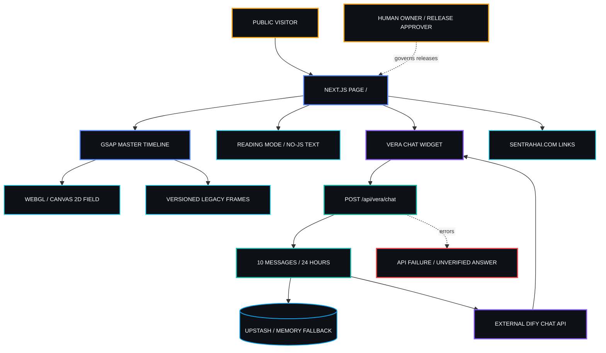
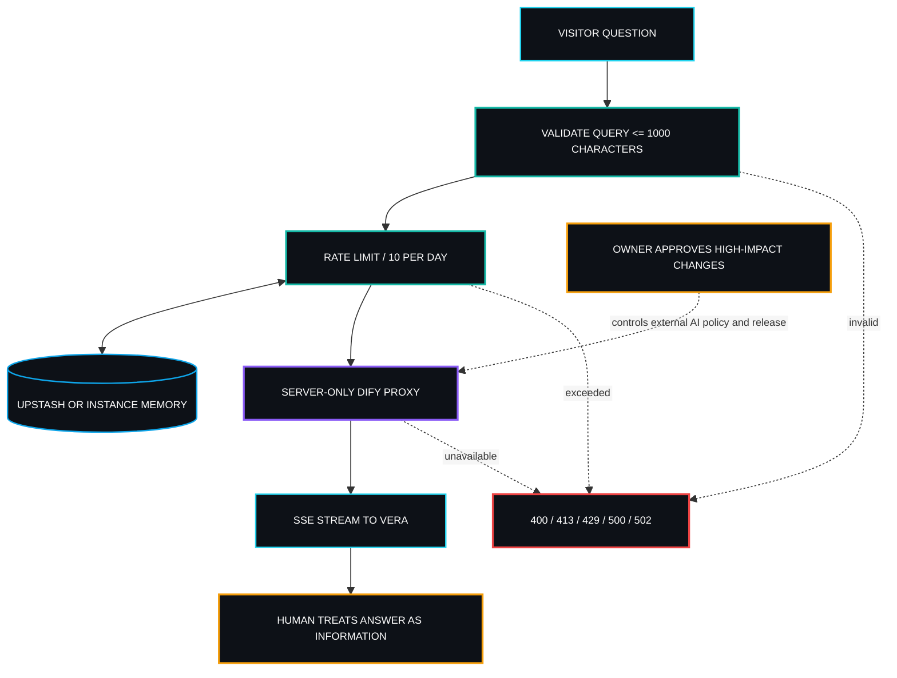

<!--
SENTRA README / SENTRAVERSE NEURAL
Product-first documentation, based on the checked repository and Sentra README Design Contract v2.1.
Status descriptions distinguish implementation evidence from executed verification.
-->

<table width="100%">
<tr>
<td width="34%" align="center" valign="middle">

<a href="https://sentraverseii.vercel.app/">
  
</a>

<small><b><code>SENTRAVERSE NEURAL</code></b></small>

<small>Cinematic brand experience · Public web application</small>


</td>
<td width="66%" valign="top">

**SENTRA / SENTRAVERSE NEURAL**

<a href="https://sentraverseii.vercel.app/">
  
</a>

**Operational signal:** Fifteen chapters · Five divisions in the current implementation · One continuous scroll-driven narrative.

<a href="https://sentrahai.com/"><b>Sentra Artificial Intelligence</b></a>

A cinematic introduction to the Sentra ecosystem, from a single neural connection to the founder's film, with Vera available as a separate AI-assisted information surface.

<small>Architected and built by <b>dr. Ferdi Iskandar (the Gaffer)</b>.</small>

<a href="https://github.com/gaffercode/Sentraverse"></a>
<a href="https://sentraverseii.vercel.app/"></a>
<a href="https://sentrahai.com/"></a>

<sub><code>VISITOR → STORY → NEURAL FIELD → DIVISIONS → THE LEGACY → HUMAN EXPLORATION</code></sub>

</td>
</tr>
</table>

## 01 / ORIGIN SIGNAL

**One living network. One story. One ecosystem.**

Sentraverse Neural is the public-facing cinematic journey of Sentra Artificial Intelligence. It turns biological connections into a visual metaphor for an interconnected organization, without presenting the website as a clinical system. The experience was separated from the broader `sentraverse` capsule on **9 October 2026** so that its runtime, assets, tests, and release lifecycle can remain independent.

Visitors move through **15 chapters** on a single GSAP master timeline. The journey begins with an origin, forms neurons and signals, crosses a synapse, reveals the Sentraverse network, introduces the **five divisions currently encoded in the product**, and closes on **THE LEGACY**—a versioned, scroll-scrubbed film sequence depicting the human behind the system. **Vera** is an optional floating conversational interface that calls a separate Dify-powered service through a server-side route.

**Intended audience:** public visitors exploring Sentra on desktop or touch devices, visitors who prefer reduced motion or use the page without JavaScript, visitors asking high-level ecosystem questions through Vera, and the human product owner overseeing story and releases.

**In scope:** the single-page narrative, interactive neural renderer, film frames, accessibility fallback, Vera widget and server proxy, testing, and capsule-local operations.

**Out of scope:** accounts, payments, analytics, patient records, clinical decision support, ownership of the broader `sentrahai.com` pages, and independent AI clinical claims. Outbound ecosystem pages are linked, not imported.

<table width="100%">
<tr>
<td width="33%" valign="top">
<small><b><code>I · NARRATIVE</code></b></small>

<small>One pinned journey. Fifteen chapters. A timeline shared by motion, stage, and film.</small>
</td>
<td width="33%" valign="top">
<small><b><code>II · EXPERIENCE</code></b></small>

<small>WebGL field, Canvas 2D fallback, mobile layout, reduced-motion and no-JavaScript reading paths.</small>
</td>
<td width="33%" valign="top">
<small><b><code>III · INFORMATION</code></b></small>

<small>Vera's optional chat proxy, bounded inputs and request limits, with AI behavior defined outside this repository.</small>
</td>
</tr>
</table>

## 02 / DOCTRINE

> [!IMPORTANT]
> **The story may be cinematic; its implementation must remain inspectable.** Sentraverse is a brand gateway, not a medical advice service or a clinical decision engine.

<table width="100%">
<tr>
<td width="50%" valign="top">
<small><b><code>ONE MASTER CLOCK</code></b></small>

<small>`components/neural/timeline.ts` governs chapter transitions, signal handoffs and film timing. New motion must respect the mapped phases and their tests.</small>
</td>
<td width="50%" valign="top">
<small><b><code>READABLE WITHOUT EFFECTS</code></b></small>

<small>Reduced-motion visitors receive unpinned reading mode. WebGL failures fall back to Canvas 2D; the chapter text remains accessible if rendering is unavailable.</small>
</td>
</tr>
<tr>
<td width="50%" valign="top">
<small><b><code>IMMUTABLE FILM VERSIONS</code></b></small>

<small>THE LEGACY uses frame sequences under `public/legacy-film/&lt;version&gt;/`. Re-exports create a new version; existing deployed frames are not overwritten.</small>
</td>
<td width="50%" valign="top">
<small><b><code>ONE CAPSULE, OWN RUNTIME</code></b></small>

<small>Node, pnpm lockfile, scripts, project contract and build configuration belong to this repository. External Sentra pages are ordinary hyperlinks, not parent dependencies.</small>
</td>
</tr>
<tr>
<td width="50%" valign="top">
<small><b><code>NO MAGIC WITHOUT AUDIT</code></b></small>

<small>Describe the actual source, test, failure mode and verification status behind each capability. A configured service is not automatically a verified service.</small>
</td>
<td width="50%" valign="top">
<small><b><code>HUMAN PUBLICATION AUTHORITY</code></b></small>

<small>dr. Ferdi Iskandar owns brand decisions, clinical messaging, credentials, merges and production releases. Automated checks provide evidence, not approval.</small>
</td>
</tr>
</table>

## 03 / PRODUCT TOPOLOGY

<p align="center">


</p>

<details open>
<summary><b><code>LIVE TOPOLOGY // EXPERIENCE & SERVICE BOUNDARIES</code></b></summary>



</details>

### Component map

<table width="100%">
<tr>
<td width="50%" valign="top">
<small><b><code>01 · NARRATIVE CORE</code></b></small>

<small><b>`components/neural/`</b></small>

<small>`story.ts` defines the fifteen chapters and five current divisions; `timeline.ts` maps phases and film beats; `NeuralJourney.tsx` owns GSAP matchMedia lifecycle, scroll, sound, progress trace and accessibility modes.</small>
</td>
<td width="50%" valign="top">
<small><b><code>02 · LIVING FIELD</code></b></small>

<small><b>`renderer.ts` and companions</b></small>

<small>`geometry.ts`, `signal.ts`, `handoff.ts`, `tactile.ts` and related modules generate the neural structure, activity cycle and pointer interaction with a Canvas fallback.</small>
</td>
</tr>
<tr>
<td width="50%" valign="top">
<small><b><code>03 · THE LEGACY</code></b></small>

<small><b>`LegacyScene.tsx` · `film.ts` · `morph.ts`</b></small>

<small>Versioned still frames render against the shared master clock. `public/legacy-film/v1/` contains 120 frames plus a poster; the film is not a seeked HTML video.</small>
</td>
<td width="50%" valign="top">
<small><b><code>04 · VERA INFORMATION SURFACE</code></b></small>

<small><b>`components/VeraNeuralWidget.tsx` · `app/api/vera/chat/`</b></small>

<small>Client-side SSE reader, question validation, daily counter, and server-only Dify proxy. Upstream model, prompt, and data retention are managed outside the repository.</small>
</td>
</tr>
</table>

### Capability matrix

| Capability | Status | Evidence | Important boundary |
|---|---|---|---|
| <small>15-chapter, scroll-scrubbed narrative</small> | <small>**IMPLEMENTED**</small> | <small>`story.ts`, `timeline.ts`, `e2e/neural.spec.ts`</small> | <small>Performance varies by device.</small> |
| <small>Five division discoveries and SentraSquad</small> | <small>**IMPLEMENTED**</small> | <small>`story.ts` and neural E2E cases</small> | <small>Four-division branding proposal is not aligned with current copy.</small> |
| <small>WebGL neural field with Canvas fallback</small> | <small>**IMPLEMENTED**</small> | <small>`renderer.ts`, E2E coverage</small> | <small>GPU and browser support vary.</small> |
| <small>Reduced motion and no-JavaScript reading</small> | <small>**IMPLEMENTED**</small> | <small>`NeuralJourney.tsx`, E2E coverage</small> | <small>Safari/iOS release check is separate.</small> |
| <small>THE LEGACY versioned frame sequence</small> | <small>**IMPLEMENTED**</small> | <small>`film.ts`, `public/legacy-film/v1/`, tests</small> | <small>Existing version directories are immutable.</small> |
| <small>Vera streaming chat proxy</small> | <small>**IMPLEMENTED**</small> | <small>`route.ts`, `VeraNeuralWidget.tsx`</small> | <small>Live Dify behavior and content accuracy not verified in this documentation revision.</small> |
| <small>10-message daily rate limiting</small> | <small>**IMPLEMENTED**</small> | <small>`limit.ts`, `limit.test.mjs`</small> | <small>Shared durability depends on Upstash; memory fallback is per instance.</small> |
| <small>Robots and Organization structured data</small> | <small>**IMPLEMENTED**</small> | <small>`app/robots.ts`, `app/page.tsx`</small> | <small>Canonical URL and sitemap remain pending.</small> |
| <small>Production analytics / real-user performance telemetry</small> | <small>**NOT IMPLEMENTED**</small> | <small>`docs/observability.md`</small> | <small>INP/LCP field data unavailable.</small> |

## 04 / THE ENGINE ROOM

<table width="100%">
<tr>
<td width="33%" valign="top">
<small><b><code>FRONTEND</code></b></small>

<small>Next.js 16 App Router, React 19, TypeScript 5.9, GSAP 3.15 with ScrollTrigger and SplitText, Tailwind CSS 4 preflight, Inter and Plus Jakarta Sans.</small>
</td>
<td width="33%" valign="top">
<small><b><code>SERVER</code></b></small>

<small>Node.js 24 route runtime for Vera, Dify `chat-messages` streaming proxy and optional Upstash Redis REST API.</small>
</td>
<td width="33%" valign="top">
<small><b><code>DELIVERY</code></b></small>

<small>Independent pnpm 11.21.0 lockfile, webpack build, GitHub Actions lint/test/build, and documented Vercel release workflow.</small>
</td>
</tr>
</table>

### Repository anatomy

```text
Sentraverse/
├── AGENTS.md                       # Local agent and repository rules
├── README.md                       # Product and operator front door
├── project.contract.json           # Standalone lifecycle and owner
├── package.json                    # Next.js scripts and exact dependencies
├── pnpm-lock.yaml                   # Capsule-owned dependency resolution
├── pnpm-workspace.yaml              # Capsule-local workspace
├── app/
│   ├── page.tsx                     # Public cinematic page
│   ├── layout.tsx                   # Fonts, metadata, Vera mount
│   ├── robots.ts                    # Robots metadata
│   └── api/vera/chat/               # POST proxy and rate limit
├── components/
│   ├── neural/                      # Story, timeline, renderer and film
│   └── VeraNeuralWidget.tsx         # Chat client
├── public/
│   ├── brand/sentraverse-logo.png   # Official transparent neural mark
│   ├── neural-face.webp             # Product visual asset
│   └── legacy-film/v1/              # Versioned frames and poster
├── e2e/                             # Chromium journey and smoke tests
├── scripts/                         # pnpm wrapper, dry-run, film tools
├── docs/                            # Architecture, security and operations
├── .agents/                         # Capsule decisions and handoff
└── .github/workflows/ci.yml         # Lint / tests / build
```

**Sovereignty boundary:** the source and dependencies live inside this repository. `sentrahai.com` is linked through absolute URLs generated by `sentra(path)`, not imported as source code. The standalone contract is in [`project.contract.json`](project.contract.json); empirical extraction status is listed below.

## 05 / SIGNAL PATH

The cinematic page and the conversational assistant have **different execution paths**. Scroll and film rendering run in the browser; only Vera's chat request crosses into a server and an external AI provider.

<details open>
<summary><b><code>VERA // REQUEST, CONTROL, FAILURE & HUMAN BOUNDARY</code></b></summary>



</details>

Vera is **not an approved clinical advisory tool**. Its external Dify prompt, knowledge base, model, and retention policies are not maintained or audited here. The widget currently includes clinical/regulatory quick-prompt topics without a visible informational-use disclaimer; this is a recorded product-safety review item, not a completed safeguard. See [regulatory and clinical safety](docs/regulatory-safety.md).

## 06 / BUILD PROTOCOL

### Prerequisites

- **Node.js 24** (`>=24 <25`) and **pnpm 11.21.0** (as defined in [`package.json`](package.json)).
- No monorepo root installation, parent package import, or shared lockfile.
- Optional Chrome/Chromium for Playwright browser tests and film tooling.
- Optional Dify credentials for an operational Vera conversation; the cinematic journey runs without them.

### Install, develop and run

Run from this repository's root:

```bash
node scripts/pnpm.mjs install --frozen-lockfile
node scripts/pnpm.mjs run dev
```

Open **http://127.0.0.1:4346**.

To run a local production build:

```bash
node scripts/pnpm.mjs run build
node scripts/pnpm.mjs run start
```

### Configuration

Store server-only values in git-ignored `.env.local` or the host's environment configuration. **Never commit credentials.**

| Variable | Required | Role | Boundary |
|---|---|---|---|
| <small>`DIFY_API_KEY`</small> | <small>For Vera only</small> | <small>Dify bearer credential</small> | <small>Server-only; missing key returns HTTP 500 for chat.</small> |
| <small>`DIFY_API_URL`</small> | <small>No</small> | <small>Overrides default `https://api.dify.ai/v1`</small> | <small>Server-only.</small> |
| <small>`KV_REST_API_URL`</small> | <small>No</small> | <small>Upstash REST endpoint</small> | <small>Used with the token; absent pair enables memory fallback.</small> |
| <small>`KV_REST_API_TOKEN`</small> | <small>No</small> | <small>Upstash REST bearer token</small> | <small>Server-only.</small> |

### Verification commands

```bash
node scripts/pnpm.mjs run lint
node scripts/pnpm.mjs run typecheck
node scripts/pnpm.mjs run test
node scripts/pnpm.mjs run build
node scripts/pnpm.mjs run deploy:dry-run
node scripts/pnpm.mjs run test:e2e
```

Playwright E2E requires a running application and installed browser; its target can be configured using `PLAYWRIGHT_BASE_URL`. The latest recorded automated evidence is historical and **must not** be interpreted as a new test run for this README change.

### Promotion and rollback

```mermaid
%%{init: {"flowchart": {"htmlLabels": false, "padding": 20}, "themeVariables": {"fontFamily": "monospace", "fontSize": "11px"}}}%%
flowchart LR
  DEV["SCOPED DEVELOPMENT"]
  CI["LINT / TEST / BUILD"]
  REVIEW["DIFF & SECURITY REVIEW"]
  AUTH["GAFFER APPROVAL"]
  PROD["VERCEL PRODUCTION"]
  ROLL["PREVIOUS DEPLOYMENT / REVERT"]

  DEV --> CI
  CI --> REVIEW
  REVIEW --> AUTH
  AUTH --> PROD
  PROD -. incident .-> ROLL
  ROLL --> DEV

  classDef core fill:#0D1117,stroke:#5B8CFF,color:#ffffff,stroke-width:2px;
  classDef control fill:#0D1117,stroke:#14B8A6,color:#ffffff,stroke-width:2px;
  classDef authority fill:#0D1117,stroke:#F59E0B,color:#ffffff,stroke-width:2px;
  classDef success fill:#0D1117,stroke:#10B981,color:#ffffff,stroke-width:2px;
  classDef danger fill:#0D1117,stroke:#EF4444,color:#ffffff,stroke-width:2px;

  class DEV,CI core;
  class REVIEW control;
  class AUTH authority;
  class PROD success;
  class ROLL danger;
```

<details>
<summary><b><code>PROMOTION STATE // REVIEW BEFORE PUBLICATION</code></b></summary>



</details>

The repository's CI is configured to run lint, unit tests and build for pull requests targeting `main`. Browser E2E is **not** part of CI. Production is documented at [`sentraverseii.vercel.app`](https://sentraverseii.vercel.app/), with final canonical domain still pending. Releases, credentials and production changes require explicit approval from the human owner. Rollback is by promoting the previous Vercel deployment or reverting the affected commit; see [deployment](docs/deployment.md).

## 07 / THE SENTRA OPERATING STANDARD

**No magic without audit.**  
**No automation without verification.**  
**No production promotion without rollback.**  
**No sensitive data without explicit security boundaries.**  
**No expansion without one solved problem first.**

| Operating question | Product-specific answer |
|---|---|
| <small>What problem is solved?</small> | <small>A coherent, accessible cinematic entry to Sentra's ecosystem.</small> |
| <small>Who owns the final decision?</small> | <small>dr. Ferdi Iskandar (the Gaffer).</small> |
| <small>What is outside scope?</small> | <small>Clinical advice, patient data, accounts, payment flows, and the wider Sentra website runtime.</small> |
| <small>What can fail?</small> | <small>GPU renderer, asset loading, external Dify, Redis, unverified assistant content, release/configuration.</small> |
| <small>How is it checked?</small> | <small>Source-reviewed contracts, unit tests, Playwright scenarios, lint, types, build, documented manual checks.</small> |

## 08 / SENTRA FOUNDATION · AGENT-FIRST ENGINEERING

This repository is a **standalone Sentra product capsule**, documented within the SAFRS-governed engineering ecosystem.

**Human-Governed · Agent-Executed · Machine-Enforced.**

- **Human governs:** product intent, claims, founder identity, high-impact changes, credentials and publication.
- **Agents execute:** scoped implementation, engineering documentation and evidence preparation.
- **Machines enforce:** test assertions, lint, types, build and configured CI gates.
- **Standalone proof:** a project is certified sovereign only after **empirical extraction testing** outside the parent monorepo. The current published documentation does **not** establish a completed extraction proof.

<p align="center">


</p>

## 09 / SENTRA DIVISIONAL HOME

<table width="100%">
<tr>
<td width="50%" valign="top">


<small><b><code>SENTRA ARTIFICIAL INTELLIGENCE</code></b></small>

<small>Product and brand ecosystem that Sentraverse introduces. The site links visitors to `sentrahai.com` and its ecosystem pages.</small>
</td>
<td width="50%" valign="top">


<small><b><code>SENTRAVERSE NEURAL</code></b></small>

<small>Public cinematic brand experience. Its repository/contract classifies the capsule under the `healthcare` engineering domain; this does not make the public site a clinical runtime.</small>
</td>
</tr>
</table>

**Brand alignment decision outstanding:** `components/neural/story.ts` currently has five divisions. `docs/product-scope.md` records a later four-division **Sentraverse Intelligence** brand proposal. The implementation and the public README retain the factual five-division state until the owner decides whether to change product copy.

## 10 / SECURITY · TRUST · DATA BOUNDARY

<table width="100%">
<tr>
<td width="50%" valign="top">
<small><b><code>AUTHENTICATION</code></b></small>

<small>Public site; no application login, user roles or local user accounts. The optional chat route accepts anonymous requests.</small>
</td>
<td width="50%" valign="top">
<small><b><code>INPUT LIMITS</code></b></small>

<small>Questions must be non-empty strings no longer than 1,000 characters. The route returns 400 or 413 for invalid inputs, 429 after the per-visitor limit.</small>
</td>
</tr>
<tr>
<td width="50%" valign="top">
<small><b><code>SERVER SECRETS</code></b></small>

<small>Dify and Upstash credentials remain on the server. No environment values belong in this public README, static assets, or client source.</small>
</td>
<td width="50%" valign="top">
<small><b><code>EXTERNAL TRUST</code></b></small>

<small>Dify handles AI inference and retention outside this repo. Upstash may hold a 32-character prefix of a SHA-256 hash of visitor IP for the counter, with 24-hour expiry.</small>
</td>
</tr>
</table>

`next.config.mjs` configures response security headers including `X-Content-Type-Options`, frame denial, referrer policy, permissions policy, HSTS and CSP. **Known caveats:** CSP currently allows `'unsafe-inline'` and `'unsafe-eval'` scripts; `x-forwarded-for` can be spoofed on an untrusted proxy path; Vera forwards the browser-provided `user` field to Dify; and the dry-run script's `SERVER_ONLY` list is empty, so its output does **not** prove Vera secrets absent from the client bundle. Those are open engineering/security review items, not claims of complete hardening.

> [!CAUTION]
> The site does not accept patient records or perform clinical decisions. Vera's external answers may still include incorrect clinical or regulatory statements. Do not treat generated answers as clinical guidance, regulatory approval or verified institutional policy.

See [security](docs/security.md), [data handling](docs/data.md) and [clinical safety](docs/regulatory-safety.md).

## 11 / API · INTEGRATION SURFACE

| Method / interface | Route / target | Responsibility | Trust / failure |
|---|---|---|---|
| <small>GET</small> | <small>`/`</small> | <small>Render the public story and mount Vera</small> | <small>No login; readable fallback is available.</small> |
| <small>GET</small> | <small>`/legacy-film/v1/*`</small> | <small>Serve immutable versioned frames</small> | <small>Missing/not-yet-loaded frames use the closest loaded frame when possible.</small> |
| <small>GET</small> | <small>`/robots.txt`</small> | <small>Permit crawler access</small> | <small>Canonical and sitemap not yet configured.</small> |
| <small>POST</small> | <small>`/api/vera/chat`</small> | <small>Validate, rate-limit, proxy and stream</small> | <small>400 / 413 / 429 / 500 / 502 error paths.</small> |
| <small>POST (server)</small> | <small>Dify `/chat-messages`</small> | <small>External AI stream using server bearer key</small> | <small>Provider or credential failure is surfaced without raw upstream error text.</small> |
| <small>POST (server)</small> | <small>Upstash `/pipeline`</small> | <small>Daily counter, TTL and hashed-IP key</small> | <small>2-second timeout; local-memory fallback if unavailable.</small> |
| <small>Outbound link</small> | <small>`https://sentrahai.com`</small> | <small>Open broader Sentra ecosystem pages</small> | <small>Separate capsule and runtime, never imported into this app.</small> |

**Vera request:** JSON body with required `query`, optional `conversation_id` and optional `user`. Successful responses use `text/event-stream`. The client stores the conversation ID in React state for the current tab only. Detailed contracts: [integrations](docs/integrations.md).

## 12 / DATA · PERSISTENCE · OBSERVABILITY

<table width="100%">
<tr>
<td width="33%" valign="top">
<small><b><code>STATIC ASSETS</code></b></small>

<small>Brand logo, face image, and versioned film frames are committed to the repository and published intentionally.</small>
</td>
<td width="33%" valign="top">
<small><b><code>EPHEMERAL / EXTERNAL STATE</code></b></small>

<small>Vera conversation ID lives in client memory. Dify stores or processes conversations under external provider policy. Upstash counter has a 24-hour TTL, else ephemeral instance memory.</small>
</td>
<td width="33%" valign="top">
<small><b><code>OBSERVABILITY</code></b></small>

<small>Runtime errors and request codes appear in Vercel logs; CI build output in GitHub Actions. No in-repository uptime monitoring, app analytics or RUM instrumentation is documented.</small>
</td>
</tr>
</table>

## 13 / FAILURE MODES · LIMITATIONS · TROUBLESHOOTING

| Signal / symptom | Meaning | Operator action |
|---|---|---|
| <small>WebGL unavailable or context lost</small> | <small>Canvas 2D fallback is expected.</small> | <small>Verify chapter readability and inspect renderer behavior.</small> |
| <small>Reduced-motion setting</small> | <small>Unpinned reading presentation is expected.</small> | <small>Verify content remains complete and navigable.</small> |
| <small>Vera HTTP 500</small> | <small>Missing Dify key or server exception.</small> | <small>Check server-only environment and runtime logs; escalation for credential changes.</small> |
| <small>Vera HTTP 502</small> | <small>Dify unavailable, non-2xx or missing response stream.</small> | <small>Check provider status/quota and server logs.</small> |
| <small>Vera HTTP 429</small> | <small>Message budget exceeded.</small> | <small>Respect `Retry-After`; inspect Upstash only when incident response requires it.</small> |
| <small>Unexpected reset of daily limit</small> | <small>Upstash absent/unreachable and per-instance memory in use.</small> | <small>Inspect optional Redis environment configuration.</small> |
| <small>Dry-run says build artifact missing</small> | <small>`.next/BUILD_ID` not created.</small> | <small>Run a fresh build before the dry-run.</small> |

**Known limitations:** no confirmed field INP/LCP metrics, no current Safari/iOS release test evidence, no unit/E2E test for Vera's widget, no direct automated route contract test, no canonical URL/sitemap, and no automated clinical-content verification of the external Dify app. No production health/uptime monitor or alert routing is documented.

For operational response, see [troubleshooting](docs/troubleshooting.md), [runbook](docs/runbook.md) and [observability](docs/observability.md).

## 14 / OFFICIAL SPONSOR & INSTITUTIONAL CONTEXT

No external sponsor is declared for this product. Sentraverse Neural is developed under **Sentra Artificial Intelligence**. The separate brand kit is currently described as **proposed for approval**, not as an independently certified corporate standard: [Sentraverse brand kit](docs/brand/README_START_HERE.md).

## 15 / OPEN CHANNEL

<a href="https://sentrahai.com/"></a>
<a href="https://github.com/gaffercode/Sentraverse"></a>
<a href="https://www.linkedin.com/in/dr-ferdi-iskandar-1b620a3b5"></a>
<a href="https://medium.com/@drferdiiskandar"></a>

For a potential vulnerability, **contact the human repository owner privately** rather than publishing credentials or security details in a public issue.

## 16 / ACTIVE STACK

| Layer | Repository-evidenced technology |
|---|---|
| <small>Web framework and UI</small> | <small>Next.js 16.3.6, React 19.3.0, React DOM 19.3.0</small> |
| <small>Motion and rendering</small> | <small>GSAP 3.15.0, WebGL and Canvas 2D APIs</small> |
| <small>Styling and fonts</small> | <small>Tailwind CSS 4.3.3 (preflight), Inter, Plus Jakarta Sans, CSS modules</small> |
| <small>Language / runtime</small> | <small>TypeScript 5.9.3, Node.js 24</small> |
| <small>Package / build</small> | <small>pnpm 11.21.0, webpack-backed Next.js build</small> |
| <small>Server and AI integration</small> | <small>Next.js Node route, Dify streaming API, optional Upstash Redis REST</small> |
| <small>Tests / delivery</small> | <small>Node test runner, ESLint 9, Playwright 1.63.0, GitHub Actions, documented Vercel host</small> |

## 17 / INSTRUMENTATION

**Technology surface:** only capabilities used or declared by this repository are listed.

<table width="100%">
<tr>
<td width="50%" valign="top">
<small><b><code>01 · LANGUAGES & RUNTIMES</code></b></small>

<small>TypeScript / JavaScript ESM, Node.js 24, browser canvas and WebGL APIs.</small>
</td>
<td width="50%" valign="top">
<small><b><code>02 · FRONTEND & UI</code></b></small>

<small>Next.js App Router, React 19, GSAP ScrollTrigger / SplitText, Tailwind preflight, CSS modules, next/font.</small>
</td>
</tr>
<tr>
<td width="50%" valign="top">
<small><b><code>03 · BACKEND & API</code></b></small>

<small>Next.js route handler: JSON input, request validation and SSE pass-through.</small>
</td>
<td width="50%" valign="top">
<small><b><code>04 · AI & AUTOMATION</code></b></small>

<small>External Dify AI orchestration accessed from the server. No AI model is hosted or trained in this repository.</small>
</td>
</tr>
<tr>
<td width="50%" valign="top">
<small><b><code>05 · DATA & STORAGE</code></b></small>

<small>Versioned repository assets; Upstash counter when configured; ephemeral in-memory fallback and browser conversation ID.</small>
</td>
<td width="50%" valign="top">
<small><b><code>06 · DELIVERY & OPERATIONS</code></b></small>

<small>GitHub Actions CI, standalone project contract, Vercel deployment path, explicit owner-controlled releases and rollback.</small>
</td>
</tr>
<tr>
<td width="50%" valign="top">
<small><b><code>07 · TESTING & QA</code></b></small>

<small>`node --test` for leaf modules and rate limits, Playwright Chromium journey cases, ESLint, TypeScript and production build.</small>
</td>
<td width="50%" valign="top">
<small><b><code>08 · SECURITY & OBSERVABILITY</code></b></small>

<small>Input/rate controls, response headers, server-side keys, Vercel runtime logs and explicitly recorded audit gaps.</small>
</td>
</tr>
</table>

## 18 / DOCUMENTATION · CONTRIBUTION · LICENSE

### Documentation map

| Concern | Canonical reference |
|---|---|
| <small>Purpose and users</small> | <small>[Product scope](docs/product-scope.md)</small> |
| <small>Architecture and motion</small> | <small>[Architecture](docs/architecture.md) · [Neural journey](docs/neural-journey.md)</small> |
| <small>Setup and testing</small> | <small>[Development](docs/development.md) · [Testing](docs/testing.md) · [Verification record](docs/verification.md)</small> |
| <small>Vera API and persistence</small> | <small>[Integrations](docs/integrations.md) · [Data](docs/data.md)</small> |
| <small>Security and clinical boundary</small> | <small>[Security](docs/security.md) · [Regulatory safety](docs/regulatory-safety.md)</small> |
| <small>Production operations</small> | <small>[Deployment](docs/deployment.md) · [Runbook](docs/runbook.md) · [Troubleshooting](docs/troubleshooting.md) · [Observability](docs/observability.md)</small> |
| <small>Governance and decisions</small> | <small>[Governance](docs/governance.md) · [Agent guidance](AGENTS.md) · [Decision log](.agents/DECISIONS.md)</small> |
| <small>Brand kit</small> | <small>[Brand identity README](docs/brand/README_START_HERE.md)</small> |

### Contribution

This is an owner-governed public repository. Review [`AGENTS.md`](AGENTS.md) and [`docs/governance.md`](docs/governance.md) before proposing changes. Scope changes, verify locally, submit reviewable diffs and obtain owner approval for merges and publication. A separate external contribution process is **not** defined in the repository.

### License

**MIT** — see [LICENSE](LICENSE). No separate sponsor or certification claim is implied by this license.

### Support & security reporting

For usage or operational issues, consult [the runbook](docs/runbook.md). Send sensitive disclosures privately to the repository owner; do not include API keys, private visitor information or credentials in a public issue.

## 19 / VERIFICATION STATUS

The following results distinguish **past recorded tests** from **checks performed during this README-only change**. No old result is presented as a fresh run.

| Surface | Recorded status | Evidence / command | Limitation |
|---|---|---|---|
| <small>Install</small> | <small>**PASS — 20 Nov 2026 record**</small> | <small>`node scripts/pnpm.mjs install --frozen-lockfile`</small> | <small>Historical evidence in `docs/verification.md`.</small> |
| <small>Typecheck</small> | <small>**PASS — 20 Nov 2026 record**</small> | <small>`node scripts/pnpm.mjs run typecheck`</small> | <small>Not rerun for README revision.</small> |
| <small>Lint</small> | <small>**PASS — 20 Nov 2026 record**</small> | <small>`node scripts/pnpm.mjs run lint`</small> | <small>Not rerun for README revision.</small> |
| <small>Unit tests</small> | <small>**59/59 — 20 Nov 2026 record**</small> | <small>`node scripts/pnpm.mjs run test`</small> | <small>Does not cover full Vera widget / route.</small> |
| <small>Build</small> | <small>**PASS — 20 Nov 2026 record**</small> | <small>`node scripts/pnpm.mjs run build`</small> | <small>Not rerun for README revision.</small> |
| <small>Deployment dry-run</small> | <small>**PASS WITH LIMITATION — recorded**</small> | <small>`node scripts/pnpm.mjs run deploy:dry-run`</small> | <small>Secret-name check currently uses an empty list.</small> |
| <small>Playwright E2E</small> | <small>**24/24 — 9 Oct 2026 record**</small> | <small>`node scripts/pnpm.mjs run test:e2e`</small> | <small>Predates Vera; not rerun on this revision.</small> |
| <small>Standalone extraction</small> | <small>**UNVERIFIED**</small> | <small>Parent control-plane `pnpm run project:verify`</small> | <small>Not executed in available evidence.</small> |
| <small>Live Vera / Dify and Upstash behavior</small> | <small>**UNVERIFIED IN THIS REVISION**</small> | <small>Owner-approved integration checks</small> | <small>Requires explicit access and real environment evidence.</small> |

<p align="center">
<b>Architected and built by dr. Ferdi Iskandar (the Gaffer) · Sentra Artificial Intelligence.</b>

<small>Sentraverse Neural — intelligence begins as connection.</small>

<sub><code>// the surface is documentation. the depth is running.</code></sub>
</p>
