<table width="100%">
<tr>
<td width="34%" align="center" valign="middle">


<br /><br />
<small><b><code>SENTRAVERSE NEURAL</code></b></small><br />
<small>Cinematic brand journey · public site</small><br /><br />


</td>
<td width="66%" valign="top">

SENTRA / SENTRAVERSE NEURAL

<b>Intelligence begins as connection.</b>

<a href="https://sentrahai.com/"><b>Sentra Artificial Intelligence</b></a><br />
The cinematic neural journey of the Sentra ecosystem: one scroll from a single connection to the
Sentra divisions and the founder's film, with Vera, a small assistant, beside it.

<small>Architected and built by <b>dr. Ferdi Iskandar (the Gaffer)</b>.</small>

<sub><code>SCROLL → MASTER TIMELINE → NEURAL FIELD → THE LEGACY → SENTRAHAI.COM</code></sub>

</td>
</tr>
</table>

## What it is

A pinned stage scrubbed by the scroll through fifteen chapters: from a single connection, through
neurons, signal and synapse, to the five Sentra divisions and SENTRA, ending on THE LEGACY, the
founder's film, whose last frame turns the left side of the face into neural tissue. A floating
chat widget, Vera, answers questions about the ecosystem through a server proxy to Dify.

Status: active, public at `https://sentraverseii.vercel.app/` (final domain pending). Split out of
the `sentraverse` capsule on 2026-10-09; earlier history lives there and in `.agents/DECISIONS.md`.

## Capabilities

| Capability | State | Evidence |
| --- | --- | --- |
| Scroll-scrubbed journey, WebGL with Canvas 2D fallback | Working | `NeuralJourney.tsx`, `renderer.ts`, e2e |
| Reading mode for reduced motion and no-JS | Working | e2e "reduced motion", "without JavaScript" |
| THE LEGACY film as an immutable frame sequence | Working | `film.ts`, `public/legacy-film/v1/` |
| Vera chat with 10 messages/visitor/day | Working; live limit unverified | `app/api/vera/chat/`, `limit.test.mjs` |
| Analytics, sitemap, canonical URL | Not implemented | `app/robots.ts` |

## Boundaries

- In scope: the home page journey, the Vera widget and route, the film frames, their tests.
- Out of scope: the rest of sentrahai.com (in the `sentraverse` capsule; linked, never imported),
  patient data, accounts, clinical decisions.
- Human owner: Gaffer (dr. Ferdi Iskandar). Default risk R2.

## Interfaces

- Exposes `/`, `/legacy-film/<version>/*`, `/robots.txt`, and `POST /api/vera/chat`.
- Consumes Dify (`DIFY_API_KEY`, optional `DIFY_API_URL`) and, optionally, Upstash Redis REST
  (`KV_REST_API_URL`, `KV_REST_API_TOKEN`). The journey itself needs no configuration.

## Stack

Next.js 16 (App Router, webpack build), React 19, gsap 3.15 (ScrollTrigger, SplitText),
Tailwind 4 for its preflight only, TypeScript 5.9, Node 24, pnpm 11.21.0 with its own lockfile.

## Quick start

```bash
node scripts/pnpm.mjs install --frozen-lockfile
node scripts/pnpm.mjs run build
node scripts/pnpm.mjs run start
```

Open http://127.0.0.1:4346. All commands: `AGENTS.md` "Commands" and `project.contract.json`.

## Documentation

| Topic | Document |
| --- | --- |
| Product scope and users | [`docs/product-scope.md`](docs/product-scope.md) |
| Architecture map | [`docs/architecture.md`](docs/architecture.md) |
| Motion design record | [`docs/neural-journey.md`](docs/neural-journey.md) |
| Decisions | [`.agents/DECISIONS.md`](.agents/DECISIONS.md) |
| Development setup | [`docs/development.md`](docs/development.md) |
| Testing and verification | [`docs/testing.md`](docs/testing.md), [`docs/verification.md`](docs/verification.md) |
| Security, data, regulatory | [`docs/security.md`](docs/security.md), [`docs/data.md`](docs/data.md), [`docs/regulatory-safety.md`](docs/regulatory-safety.md) |
| Vera API and services | [`docs/integrations.md`](docs/integrations.md) |
| Operations | [`docs/runbook.md`](docs/runbook.md), [`docs/troubleshooting.md`](docs/troubleshooting.md), [`docs/observability.md`](docs/observability.md), [`docs/deployment.md`](docs/deployment.md) |
| Governance | [`docs/governance.md`](docs/governance.md) |
| Brand kit | [`docs/brand/README_START_HERE.md`](docs/brand/README_START_HERE.md) |

## Where things are

| Path | Role |
| --- | --- |
| `components/neural/story.ts` | The chapters, `phaseOf(id)`, and `sentra(path)` for links to sentrahai.com |
| `components/neural/timeline.ts` | The master timeline, the phase-to-time tempo, THE LEGACY's beats |
| `components/neural/NeuralJourney.tsx` | `gsap.matchMedia` lifecycle, the pinned ScrollTrigger, pointer, sound, reading mode, film preload |
| `components/neural/renderer.ts`, `geometry.ts`, `signal.ts` | The neural field and its activity cycle |
| `components/neural/film.ts`, `morph.ts`, `LegacyScene.tsx` | The film as a scrubbed frame sequence and the face that becomes neural tissue |
| `components/VeraNeuralWidget.tsx`, `app/api/vera/chat/` | Vera widget, proxy route and rate limit |
| `scripts/legacy-film/` | Re-export the frames and re-measure the morph |

## Known limitations

- E2E runs locally only; Safari/iOS is a separate release check; INP/LCP field data pending.
- The Vera limit is per instance when Upstash is not configured.
- Vera's answers come from an external Dify app not reviewed here (`docs/regulatory-safety.md`).

## License

MIT. See [`LICENSE`](LICENSE).

---

_Architected and built by Drferdi._
