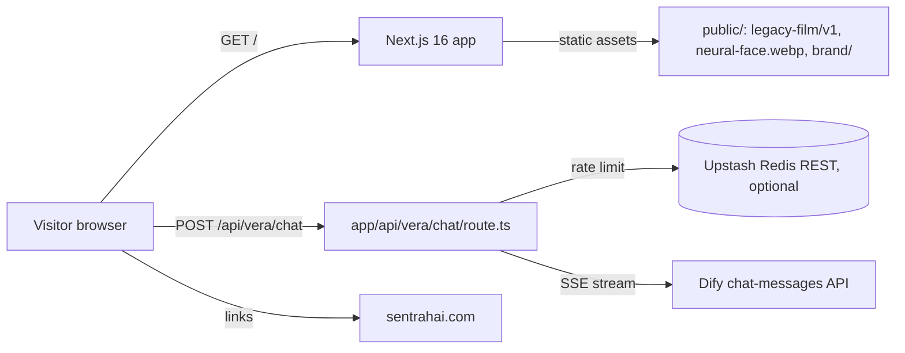

# Architecture

One public page plus one server route. The design record, with every motion knob and its
reason, is [`neural-journey.md`](neural-journey.md); this file is the map.

## Runtime topology

- Hosted on Vercel project `sentraverseii` (see [`deployment.md`](deployment.md)); locally
  `next start` on 127.0.0.1:4346.
- The page is static; the Vera route is dynamic (`runtime = 'nodejs'`).

## Components

- `app/layout.tsx` loads Inter and Plus Jakarta Sans through `next/font/google` (self-hosted at
  build), sets metadata, and mounts `components/VeraNeuralWidget.tsx` on every page.
- `app/page.tsx` renders `components/neural/NeuralJourney.tsx` (client) and an Organization
  JSON-LD block. `app/robots.ts` allows every crawler.
- `NeuralJourney.tsx` builds everything inside one `gsap.matchMedia` context (reverted on
  unmount): the master timeline from `timeline.ts`, one pinned ScrollTrigger that scrubs it, the
  pointer (`tactile.ts`), optional sound, reading mode, and the film preload.
- `story.ts` holds the chapters, the five divisions and the SentraSquad; `phaseOf(id)` throws on an
  unknown id; `sentra(path)` builds links to sentrahai.com.
- `renderer.ts` draws the neural field from `geometry.ts` in WebGL with a Canvas 2D fallback;
  `signal.ts` is the activity cycle; `handoff.ts` passes one carrier between chapters; `wake.ts`
  and `tactile.ts` react to the pointer; `face.ts` and `morph.ts` grow the face and the tissue.
- `LegacyScene.tsx` and `film.ts` draw the film as a frame sequence on a canvas, driven by the
  master clock (`ease: 'none'`).
- `VeraNeuralWidget.tsx` is a client chat panel. It keeps the conversation id in React state only
  (nothing in storage), parses the SSE stream, and offers four quick prompts behind `/`.
- `app/api/vera/chat/route.ts` validates the question, applies `limit.ts`, and proxies to Dify.

## Trust boundaries

| Boundary | Crosses | Control |
| --- | --- | --- |
| Browser → route | Question text, optional `conversation_id`, `user` | Non-empty string, ≤ 1,000 chars (413), 10/visitor/24 h (429) |
| Route → Dify | Question, `DIFY_API_KEY` bearer | Key is server-only; upstream errors become a generic 502 |
| Route → Upstash | SHA-256 prefix of client IP, `KV_REST_API_TOKEN` | 2 s timeout, memory fallback |
| Page → sentrahai.com | Plain links | No shared code or runtime |

Details: [`security.md`](security.md), [`integrations.md`](integrations.md).

## Dependencies

Runtime: `next`, `react`, `react-dom`, `gsap`, Tailwind 4 (preflight only), pinned exactly in
`package.json` and `pnpm-lock.yaml`. No other capsule, no root package (`AGENTS.md`, Standalone
contract).

## Failure modes

- No WebGL or a shader that fails to link: the Canvas 2D fallback draws the field.
- No canvas context or JavaScript disabled: the chapter text is readable as a plain page.
- WebGL context loss: the renderer switches to Canvas 2D; reduced motion parks the activity cycle.
- A frame not loaded yet: the film draws the nearest loaded one (`nearestLoaded` in `film.ts`).
- Dify key missing or upstream down: the route answers 500/502 "Vera is not available right
  now." and the rest of the page is unaffected.
- Upstash unreachable: the limit falls back to a per-instance memory count.
