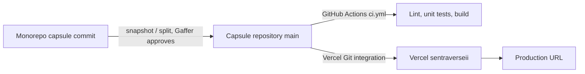

# Deployment and release

How code reaches production. Every step past a local commit needs Gaffer's explicit approval.

## Path



1. Work is committed in the monorepo under `projects/healthcare/sentraverse-neural/`.
2. Publication copies the capsule, and only the capsule, to its own public repository
   `https://github.com/gaffercode/Sentraverse` (MIT; `project.contract.json` `repository`). The
   GitHub account `drferdi` is no longer active; the old `drferdi/Sentraverse-N` is history only.
   Procedure: `git archive <commit>:projects/healthcare/sentraverse-neural` into a clone of the
   repository, check the tree is identical to the capsule, bring in any commit made on GitHub
   first, commit as `gaffercode` (author and committer), push over HTTPS as gaffercode (this
   machine's SSH key maps to `drferdi` and is denied). The first publish was `c67f2e5` on
   2026-11-20.
3. `.github/workflows/ci.yml` runs lint, unit tests and build on pushes to `main`, `master`,
   `claude/**`, `feature/**` and on pull requests. Playwright is not in CI.
4. Vercel builds and serves the site. Environment variables are set per environment in the
   Vercel project (see [`data.md`](data.md)).

## Pre-release checks

```text
node scripts/pnpm.mjs run typecheck
node scripts/pnpm.mjs run lint
node scripts/pnpm.mjs run test
node scripts/pnpm.mjs run build
node scripts/pnpm.mjs run deploy:dry-run
node scripts/pnpm.mjs run test:e2e   # local, against the build
```

`deploy:dry-run` touches no network and reads no credentials: it checks that `.next/BUILD_ID`
exists and that listed server-only names are absent from client JavaScript.

## Environments

| Environment | Where | Notes |
| --- | --- | --- |
| Local | 127.0.0.1:4346 | `.env.local` optional |
| Preview | Vercel preview URLs | Vercel SSO protected |
| Production | `https://sentraverseii.vercel.app/` | Public since 2026-10-11; final domain pending |

## Rollback

Promote the previous production deployment in Vercel, or revert the commit in the capsule
repository and let it redeploy. Film versions make asset rollback safe: older folders stay.

## Not yet decided

Final domain, canonical URL, sitemap and Open Graph image; release tagging (none exist,
`package.json` stays `1.0.0`).
